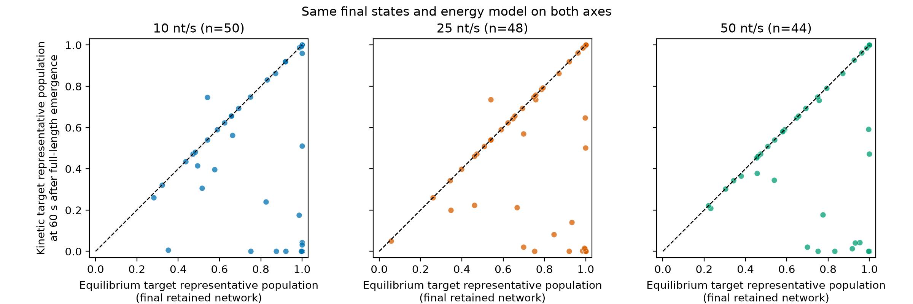
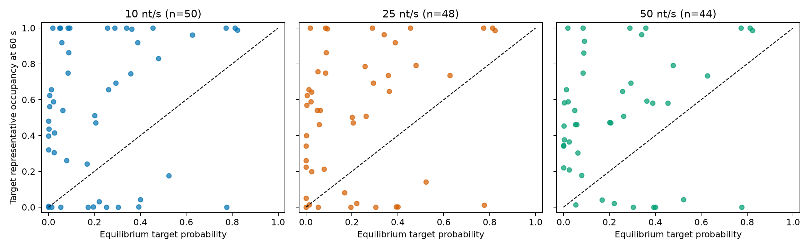
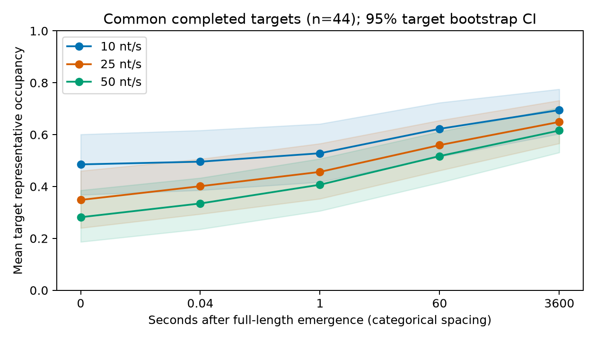
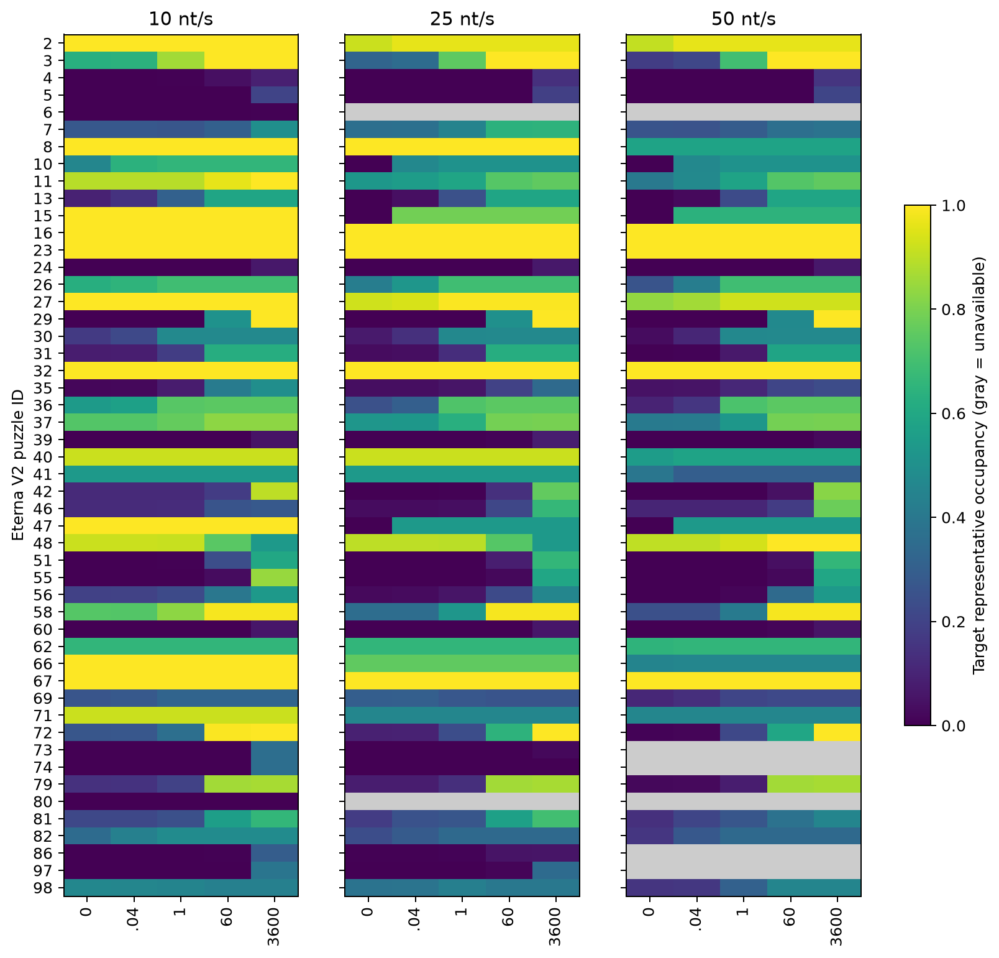
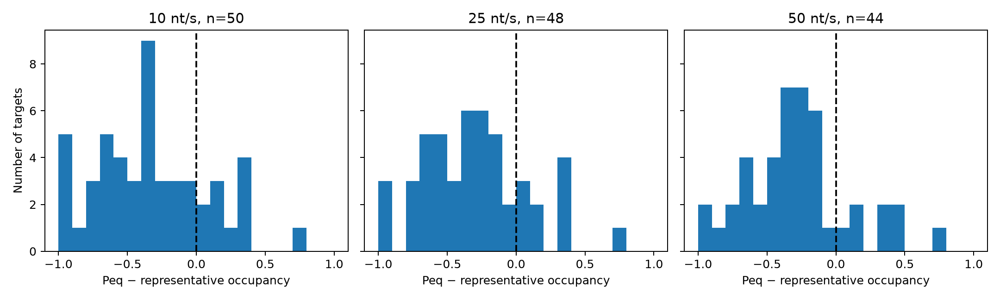

# Kinetic accessibility of synthetic RNA

Pilot evaluation of 50 Eterna100-V2 reference designs using ViennaRNA equilibrium folding and DrTransformer cotranscriptional kinetics.

## Current experiment

- 50 reference solutions sampled with seed 20261125 from 99 valid exact MFE matches.
- Paired transcription conditions: 10, 25, and 50 nt/s.
- 37 °C, Turner 2004 parameters, dangles=2; ViennaRNA 2.8.0 and DrTransformer 1.0.
- Full-length observations at 0, 0.04, 1, 60, and 3600 s after the final nucleotide emerges.
- Completed: 142/150 simulations; 8 reached the six-hour per-sequence timeout. All completed runs passed population and structure validation.
- Results and limitations: [analysis report](results/analysis_report.md). Rate comparisons are exploratory because `cg-auto` changes coarse-graining with transcription speed.
- Occupancy refers to populations assigned to macrostates whose representative exactly matches the target secondary structure; it is not exact microstate probability.

See `kinetics_aware_rna_inverse_design_protocol.md` for the research protocol and `config.json` for the recorded pilot settings.

## Environment

Create a Python 3.11 Conda environment, activate it, then install the recorded Python packages:

```bash
conda create --prefix ./.conda-env python=3.11 pip -y
conda activate ./.conda-env
python -m pip install -r requirements-lock.txt
```

`environment.yml` is an alternative Conda specification; resolved versions may differ from the pip lock.

## Data

Source: https://github.com/eternagame/eterna100-benchmarking

Revision: `8a47dde068d196279b04f0a6b0ac5985f0197f0a` (MIT license).

Download/extract that revision into `data/eterna100-benchmarking/` before regenerating inputs. `scripts/prepare_pilot.py` reads its puzzle TSV, checks validity and MFE identity, and writes the selected inputs, equilibrium baseline, exclusions, and configuration. The source checksum is recorded in `config.json`. Selected reference data retains the upstream license in `data/ETERNA_LICENSE`.

## Execution

```bash
python scripts/prepare_pilot.py
python scripts/run_rate.py 25 4
```

The runner starts four independent simulations, limits each sequence to six hours, and saves commands, raw outputs, status, and runtime in `runs/<candidate_id>/<rate>nt_s/`. `jobs/pilot_*nt_s.pbs` submit each condition on the original PBS cluster; adjust account, queue, paths, and resources for another system.

`scripts/drtransformer_observations.py` wraps the installed simulator to force the requested full-length observation times and save full-precision representative occupancies. It does not change the kinetic landscape or rate parameters. The full-length time origin is `(length-1)/rate` under this simulator's clock. Standard `.drf` files can omit low-occupancy representatives; use `full_length_states.tsv` for quantitative snapshots. Representative occupancies are coarse-grained populations, not exact microstate probabilities.

Environment directories, downloaded upstream code, logs, and raw simulation outputs are excluded from Git. Summary tables may be committed after validation.

## Analysis

```bash
python scripts/analyze_pilot.py
python scripts/report_pilot.py
```

Analysis requires the local raw outputs under `runs/`, which are not stored in this repository. Derived endpoint metrics, trajectories, run audits, bootstrap summaries, and figures are included. Timeouts remain missing results rather than zero occupancy.

### Matched equilibrium–kinetic comparison



The primary parity plot compares stationary target representative population on each run's final retained network with its kinetic population at 60 seconds. See [method and interpretation](results/matched_parity_report.md). Generate with `python scripts/plot_matched_parity.py`; validate the stationary reconstruction on small live networks with `python scripts/validate_matched_equilibrium.py`. This is not full-ensemble equilibrium.

### Original descriptive comparisons

The following scatter and original gap histogram compare exact ViennaRNA microstate probability with DrTransformer representative population. They are not matched parity/deficit measures and must not be interpreted as kinetic enrichment or trapping evidence.








